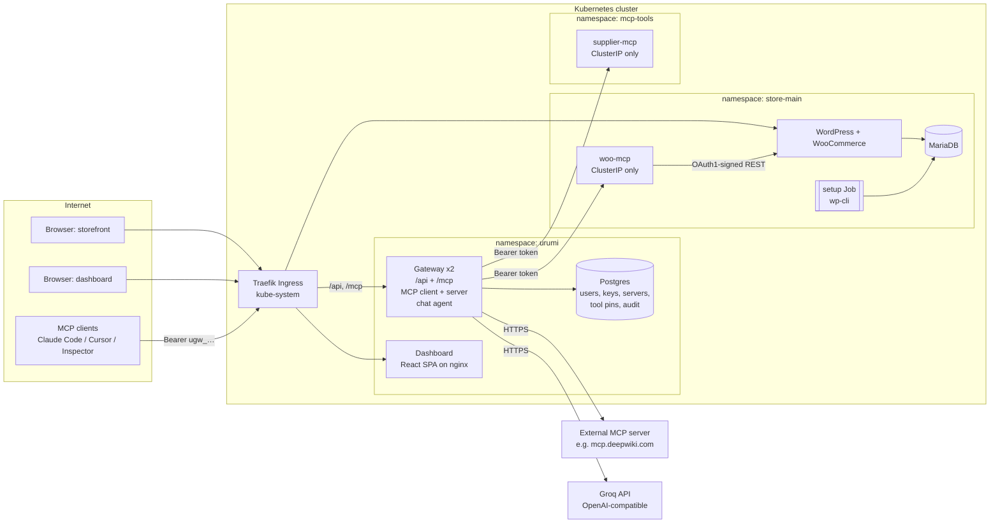

# System design and tradeoffs

## 1. Components and responsibilities

| Component | What it does | Why it exists |
|---|---|---|
| **WordPress + WooCommerce** (`charts/store`) | The store. Official `wordpress` image, Apache on :8080, runs as `www-data`. | The data source. |
| **MariaDB** | WordPress database, StatefulSet + PVC. | Persistence. |
| **setup Job** | Helm `post-install,post-upgrade` hook that runs wp-cli: installs WordPress and a *pinned* WooCommerce version, sets currency/timezone/COD/free shipping, disables "coming soon" mode, registers the MCP server's REST key, seeds sample products. Idempotent. | Reproducible stores with no clicking in wp-admin. Upgrading WooCommerce is a values change. |
| **woo-mcp** (`services/woo-mcp`) | My MCP server. Streamable HTTP, stateless. 8 tools: `list_products`, `get_product`, `create_product`, `update_product`, `list_orders`, `get_order`, `update_order_status`, `sales_summary`. | Exposes the store to AI clients. |
| **supplier-mcp** (`services/supplier-mcp`) | A second MCP server: wholesale catalog, quotes, FX conversion. Has a `list_products` tool on purpose. | Shows multi-server prompts and name collisions. |
| **Gateway** (`services/gateway`) | Dashboard API, **MCP client** to every upstream, **MCP server** for every user, chat agent, audit log, metrics. | The product. |
| **Dashboard** (`services/dashboard`) | React SPA: servers, tools, team, keys, audit, chat. | Admin and member UX. |
| **Postgres** | Gateway state. | Keys, servers, tool pins and audit must survive restarts and be shared by replicas. |

The third upstream is a public MCP server (DeepWiki, `https://mcp.deepwiki.com/mcp`) added at runtime from the dashboard. That covers the "add a server by URL" story and shows the SSRF guard accepting a public URL.

## 2. How the WooCommerce MCP server talks to the store

**Choice:** the WooCommerce REST API (`/wp-json/wc/v3`), called over the in-cluster Service. The calls are authenticated with a consumer key/secret and signed with **OAuth 1.0a (HMAC-SHA256)**.

Why REST and not WP-CLI or direct SQL:
- REST goes through WooCommerce's own validation, hooks, stock handling and order-status transitions. SQL would bypass all of that and corrupt data in subtle ways.
- WP-CLI would need the MCP server to share WordPress's volume and PHP runtime. That couples two pods and gives the MCP server far more power than it needs.
- REST needs only an HTTP connection that a NetworkPolicy can scope to one port on one pod. The key is a scoped credential, so it can't reach wp-admin.

Why OAuth 1.0a signing instead of Basic auth: WooCommerce accepts Basic auth only when `is_ssl()` is true, and in-cluster traffic is plain HTTP. With OAuth 1.0a the consumer secret never crosses the wire, and each request carries a nonce and timestamp, so a sniffed request cannot be replayed or modified.

A subtle detail I hit: WooCommerce builds the signature base string from `get_home_url()` (the *public* URL), not from the host you connect to. It also forces the scheme to `http` when the request itself isn't TLS. So `woo-mcp` connects to `http://store-wordpress.store-main.svc` but signs for `http://<public host>/wp-json/...` (see `services/woo-mcp/src/oauth.ts`). The second detail: each `key=value` pair is percent-encoded *twice* (encode key and value, then encode the joined pair). A single-encoding implementation works for simple queries and fails as soon as a value contains `:`, such as the ISO timestamps used for "orders today".

The key and secret are generated by `scripts/gen-secrets.sh`, stored in a Kubernetes Secret, and registered in WooCommerce by the setup Job (`charts/store/files/api-key.php`). Nobody copies keys out of wp-admin.

**Dates:** "orders that came in today" depends on the *store's* timezone. `list_orders` and `sales_summary` take `period: today|yesterday|last_7_days|…` and resolve it to exact UTC bounds in the store timezone. The LLM never does timezone arithmetic.

## 3. The gateway

### 3.1 Upstream connections (gateway as MCP client)

`UpstreamManager` (`services/gateway/src/upstreams.ts`) keeps **one SDK `Client` per upstream server, per replica**:

- **Connect:** `initialize`, then `tools/list` (paginated), then sync the catalogue to Postgres. The server only counts as `connected` after its tools are persisted.
- **Credentials:** the stored credential is decrypted (AES-256-GCM) only at connect time and becomes a request header, either `Authorization: Bearer …` or a custom header such as `X-API-Key`.
- **Health:** every `healthIntervalMs` each connected upstream gets an MCP `ping` with a 3 s timeout. Failure → `unreachable` with a precise reason, for example `ECONNREFUSED 10.43.12.9:3000`, `HTTP 401 … rejected the gateway's credentials`, or `No response to ping within 3000 ms`.
- **Reconnect:** exponential backoff (2 s → 30 s cap) checked every 2 s, so a restarted pod is back within seconds without anyone pressing a button.
- **Config changes** (URL, credential, enable/disable) arrive through Postgres `LISTEN/NOTIFY` and reconcile on every replica.
- **All upstream HTTP** goes through `safeFetch`, which re-checks resolved IPs at connect time (SSRF, §5).

### 3.2 Aggregation and routing (gateway as MCP server)

The gateway exposes a single Streamable HTTP endpoint, `/mcp` (`services/gateway/src/mcp.ts`).

- `tools/list` reads the **cached catalogue** from Postgres, memoised for 5 s and invalidated by events. It never waits on an upstream, so a slow or dead server cannot stall listing. A tool is listed only if all of these hold:
  - its server is enabled and connected,
  - the tool is approved,
  - the tool is enabled,
  - the caller's role is at least the tool's `minRole`.
- `tools/call` with `woocommerce__list_orders` → split on the first `__` → find the server with slug `woocommerce` → apply the same visibility check → `client.callTool('list_orders', args, {timeout})` → pass the result back. Results over 512 KB are truncated.

**Name collisions.** Every tool is exposed as `<server-slug>__<tool>`. Slugs are unique, `^[a-z][a-z0-9-]{0,23}$`, and contain no `_`, so the split is unambiguous. Two servers with `list_products` become `woocommerce__list_products` and `supplier__list_products`. Names over 64 characters (the client limit) are shortened with a stable hash suffix. I prefixed *always*, not only on collision, because then a tool's name never changes when someone else adds a server, and the prefix tells the model and the auditor which system a call touches. Descriptions also get a `[Server name]` prefix.

**Timeouts and failure semantics:**

| Situation | What the caller gets | Audit outcome |
|---|---|---|
| Upstream answers with `isError: true` | Upstream's result unchanged | `error` |
| Upstream slower than its `timeoutMs` (per server, default 15 s) | Tool result `isError`: *Upstream "supplier" did not respond within 15000 ms*. The connection stays up: slow is not dead | `timeout` |
| Upstream down (connection refused/reset, 5xx) | Tool result `isError`: *Upstream "supplier" is unreachable: ECONNREFUSED …*; the server is marked unreachable and its tools drop from `tools/list` | `error` |
| Server disabled / tool pending review | Tool result `isError` with the reason | `error` / `denied` |
| Tool unknown, or role too low | JSON-RPC error `-32602` (as the MCP spec says for unknown tools) | `denied` |
| Bad or revoked API key | HTTP 401 + `WWW-Authenticate` | `unauthorized` |

Availability problems come back as *tool results* rather than protocol errors so the LLM can read them and explain them to the user.

### 3.3 Why I wrote the downstream MCP endpoint myself

The upstream side uses the official SDK client. For the downstream side I implemented Streamable HTTP directly (about 300 lines): `initialize`, `ping`, `tools/list`, `tools/call`, the GET SSE stream for `notifications/tools/list_changed`, and `DELETE`. The reason is horizontal scaling. The SDK's server transport keeps sessions in process memory, which forces sticky sessions once there are two replicas. Here:

- `Mcp-Session-Id` is an **HMAC-signed token** bound to the user, so any replica can validate it.
- **Every request re-authenticates the API key**, so revocation takes effect immediately on all replicas. Open SSE streams re-check every 20 s.
- Change notifications (a server disabled, a tool approved, a user's role changed) fan out to all replicas through Postgres `LISTEN/NOTIFY`. Each replica pushes `tools/list_changed` to the SSE streams it holds. A client like Claude Code sees tools appear and disappear **live**.
- It is tested with the official SDK client (protocol `2025-11-25`) in `tests/e2e.mjs`, and with MCP Inspector. It also speaks `2025-06-18`, `2025-03-26` and `2024-11-05`.
- **Consistency:** each replica connects to each upstream on its own, so right after an admin adds a server the replicas can disagree briefly. Measured on k3d with DeepWiki: `tools/list` alternated 0/3 tools for about 1.5 s, then converged. Clients get `tools/list_changed` when their replica catches up.
- **Graceful shutdown:** a `preStop` pause gives Traefik time to drop the pod before `SIGTERM`. The gateway then reports not-ready, finishes in-flight calls and exits. Measured: before this, a rollback under load lost 6 of 528 calls (502/504); after it, a `rollout restart` plus a `helm rollback` lost **0 of 525**.

### 3.4 Chat agent

`services/gateway/src/agent.ts`. The agent is **just another MCP client of the gateway**:

1. `POST /api/chat` (cookie session) → the gateway mints a 5-minute agent token for the logged-in user.
2. The agent connects to `http://127.0.0.1:8080/mcp` with that token: the same endpoint, auth, permissions and audit path as Claude Code. Audit rows show `client = chat`, attributed to the user.
3. Loop, up to 8 steps: call the LLM with the MCP tools as OpenAI function tools; for each tool call, `callTool` through the gateway and stream `tool_call` / `tool_result` events to the browser over SSE; stop when the model answers without tool calls.
4. The system prompt includes the user's identity and role and the current time. It also tells the model to treat tool output as data, never as instructions.

The provider is anything OpenAI-compatible (default Groq, `openai/gpt-oss-120b`), configured with Helm values. The key lives in a Secret.

**Many tools:** above `AGENT_DIRECT_TOOL_LIMIT` (40) visible tools, the agent switches to `/mcp?mode=search`. There the gateway exposes only `gateway__search_tools` and `gateway__call_tool`, and the model finds tools on demand instead of receiving hundreds of schemas. External clients can use the same mode.

### 3.5 Tool definition pinning (rug-pull defence)

Every tool definition (description, input schema, annotations) is hashed. The first successful listing of a new server is trusted (TOFU), because the admin just added it and can see every tool. After that:
- a *new* tool arrives as **pending**,
- a *changed* description or schema arrives as **changed**, with the approved version kept for comparison.

Both are hidden from everyone until an admin reviews a side-by-side diff in the dashboard and approves it. Heuristic flags highlight common poisoning patterns: "ignore previous instructions", hidden directives, mentions of secrets, URLs or other tools, invisible Unicode. Invisible characters are also stripped from what clients receive.

## 4. Team and access

- **Roles:** `admin` manages servers, members, keys and tool policy. `member` uses tools, manages their own keys, and sees their own audit rows.
- **Per-tool policy:** each tool has `enabled` and `minRole`. By Helm default, WooCommerce write tools (`create_product`, `update_product`, `update_order_status`) are admin-only. Restricted tools are **hidden from `tools/list` and rejected if called directly**.
- **API keys:** `ugw_` + 32 base62 characters (~190 bits). Stored as HMAC-SHA256 with a server-side pepper. The plaintext is shown once and can be revoked by its owner or by an admin.
- **Dashboard sessions:** an HMAC-signed httpOnly cookie, `SameSite=Strict`, plus a custom CSRF header. Role and status are re-read from the database on every request.
- **Audit:** every `tools/call`, every `tools/list` and every rejected request: user, key prefix, client (mcp/chat), server, tool, duration, outcome, error, gateway pod. Arguments and results are **not** stored, because they contain customer PII.

## 5. Kubernetes layout

| Namespace | Workloads | Public? |
|---|---|---|
| `store-main` | wordpress (Deployment, Recreate), mariadb (StatefulSet), store-mcp (Deployment), setup (Job) | storefront through Ingress; MCP is ClusterIP and NetworkPolicy-restricted to gateway pods |
| `mcp-tools` | supplier (Deployment) | no |
| `urumi` | gateway (Deployment x2, PDB, RollingUpdate maxUnavailable 0), dashboard, postgres (StatefulSet) | `app.<domain>`: `/` → dashboard, `/api`, `/mcp` → gateway |

- **Pod Security:** all three namespaces enforce the **`restricted`** Pod Security Standard. Every container is non-root with all capabilities dropped, no privilege escalation and `RuntimeDefault` seccomp; most also have a read-only root filesystem. WordPress listens on 8080 so it can run as `www-data`. No pod mounts a ServiceAccount token, because nothing needs the Kubernetes API.
- **NetworkPolicies:** deny-all by default in every namespace, then explicit allows (see the comments in each chart's `networkpolicies.yaml`). The gateway's egress excludes RFC1918, link-local and CGNAT ranges, with explicit exceptions for the upstream namespaces. That makes it the third SSRF layer.
- **Probes:** every workload has readiness and liveness probes; slow starters also get startup probes. WordPress readiness hits `wp-login.php`, which fails without a database. Liveness hits a static file, so a database outage does not restart-loop Apache.
- **Resources:** requests and limits on every container, sized for a 4-8 GB single-node cluster.
- **Storage:** PVCs for MariaDB, WordPress and Postgres. The WordPress PVC has `helm.sh/resource-policy: keep`.
- **Secrets:** only in Kubernetes Secrets, generated per environment by `scripts/gen-secrets.sh` into git-ignored files, or supplied as `existingSecret`. Pods restart on rotation via checksum annotations.

## 6. Local vs production: only Helm values change

| Concern | Local (`values-local.yaml`) | VPS (`values-prod.yaml`) |
|---|---|---|
| Cluster | k3d (k3s in Docker), so the same distribution as prod | k3s on a VPS |
| Domains | `*.127.0.0.1.nip.io` (public wildcard DNS → 127.0.0.1, no hosts file) | real DNS A records → VPS IP |
| Ingress | Traefik (bundled with k3s), HTTP | Traefik `websecure` + TLS via cert-manager annotation |
| Images | built locally, `k3d image import`, `pullPolicy: Never` | `ghcr.io/<owner>/urumi-*` with version tags, pushed by CI |
| Storage | `local-path` (default class) | `local-path` explicitly, bigger sizes; swap the class for Longhorn/EBS on multi-node |
| Secrets | `deploy/secrets/local/*.yaml` | `deploy/secrets/prod/*.yaml` on the operator's machine, or `existingSecret` from sealed-secrets/external-secrets |
| Cookies | `COOKIE_SECURE=false` | `true` |
| Sizing | small requests, gateway x2 | larger requests/limits, dashboard x2 |

No template has an `if prod` branch. The environment is entirely in the values files.

## 7. Tradeoffs I made consciously

- **Own charts instead of Bitnami's WordPress chart.** Bitnami images moved behind a paywall in 2025. Writing the templates also means I can explain every line, including probes, PSA, NetworkPolicies and the hook Job.
- **One store, one namespace, one release.** The store chart already includes its own MCP server, so multi-store provisioning is a matter of `helm install store-<n>` in a new namespace.
- **RWO volume + setup Job co-location.** The Job uses pod affinity to land on the WordPress node. That's fine on single-node k3s. On multi-node it needs RWX storage or a different bootstrap (for example an init container).
- **The audit write is fail-open.** If the audit insert fails, the call still succeeds and the failure is logged loudly. A compliance setup would choose fail-closed. It's a one-line change.
- **Rate limits are per replica** (token bucket in memory). With N replicas the effective limit is up to N×. Fine for abuse protection; exact quotas would need Redis or Postgres.
- **Upstream credentials are static and shared.** That's what the brief asks for, and the threat model explains the consequences. Per-user upstream OAuth would be the next step.
- **The setup Job needs internet egress** (wordpress.org) to fetch the pinned WooCommerce. An air-gapped install would bake the plugin into a custom image.
